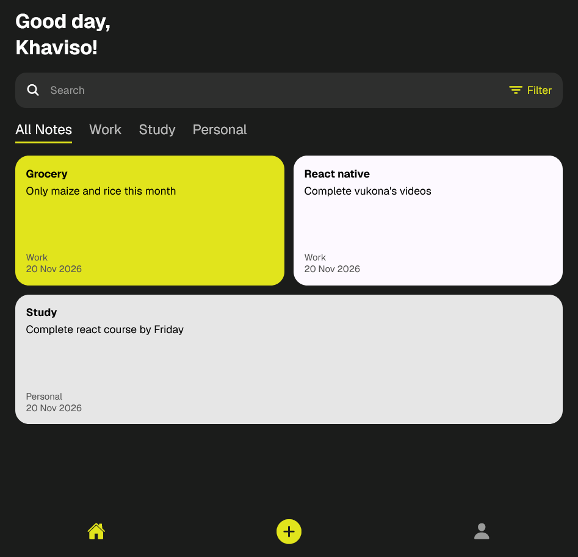

# Notes App

A secure, dark-themed notes app built with **React Native (Expo)**, **Expo Router** and **TypeScript**.
Users can register, log in, reset a forgotten password, and manage their own notes with categories, search and sorting.
All data is stored on the device using **AsyncStorage**.

[Download The Notes App APK HERE](https://drive.google.com/drive/u/0/folders/1L7zJys4r6GugmEQE3d5MCjya43qan5Jm)

---

## Application Preview



## Table of contents
1. [Features](#features)
2. [Tech stack](#tech-stack)
3. [Project structure](#project-structure)
4. [Prerequisites](#prerequisites)
5. [Cloning and running the project](#cloning-and-running-the-project)
6. [Opening the app on your phone or emulator](#opening-the-app-on-your-phone-or-emulator)
7. [Setting up password reset emails](#setting-up-password-reset-emails)
8. [Using the app](#using-the-app)
9. [How it works](#how-it-works)
10. [Building the project from scratch](#building-the-project-from-scratch)
11. [Putting the project on GitHub](#putting-the-project-on-github)
12. [Troubleshooting](#troubleshooting)

---

## Features

**User management**
- Register with email, username, password and **confirm password**
- Password rules: at least 6 characters and at least one special character (e.g. `! @ # $ %`)
- Show / hide **eye icon** on every password field
- Log in with email and password
- **Forgot password:** request a reset link by email, then set a new password from the link
- Protected routing: logged-out users only see the login, register and reset screens; logged-in users never see them
- Passwords are stored as SHA-256 hashes, never as plain text

**Profile**
- Modern profile page with avatar, name, email, notes statistics and a menu
- **Edit Profile:** change your username (the email is read-only and cannot be edited)
- **Change Password:** its own screen with new, confirm and current password
- **Log out** with a confirmation modal

**Notes**
- **Create** notes with text, category, optional title and the date added
- **Read** all of your own notes (other users' notes are never shown)
- **Update** notes; edited notes show an "edited" timestamp
- **Delete** notes with a confirmation modal ("Deleted notes are permanently removed."), from the bin icon on the note screen or by long-pressing a card on the home screen
- **Search:** every word you type must appear in the note's title or text
- **Filter / sort** by date added, newest first or oldest first, from the Filter dropdown
- **Categories:** Work, Study, Personal, plus an "All Notes" view

**Design**
- Dark theme with a yellow accent and **Geist** font throughout
- Labels on every form field
- Responsive layouts: forms and screens stay centred with a maximum width, so they look right from small phones to wide screens

## Tech stack

| Purpose | Tool |
|---|---|
| Framework | React Native with Expo |
| Language | TypeScript |
| Navigation / routing | Expo Router (file-based) |
| Storage | `@react-native-async-storage/async-storage` |
| Password hashing and reset tokens | `expo-crypto` |
| Deep links in reset emails | `expo-linking` |
| Reset emails | EmailJS (REST API) |
| Icons | `@expo/vector-icons` |
| Font | `@expo-google-fonts/geist` |

## Project structure

```
react-native-notes-app/
├── assets/
│   └── notes-app-preview.png     # Screenshot shown in this README
├── src/
│   ├── app/
│   │   ├── _layout.tsx           # Root layout, font loading and route guard
│   │   ├── note.tsx              # Add / edit / delete a note (modal screen)
│   │   ├── edit-profile.tsx      # Edit username (email is read-only)
│   │   ├── change-password.tsx   # Change password screen
│   │   ├── (auth)/               # Screens for logged-out users
│   │   │   ├── _layout.tsx
│   │   │   ├── login.tsx
│   │   │   ├── register.tsx
│   │   │   ├── forgot-password.tsx
│   │   │   └── reset-password.tsx
│   │   └── (app)/                # Screens for logged-in users (bottom tabs)
│   │       ├── _layout.tsx       # Tab bar: Home, "+", Profile
│   │       ├── index.tsx         # Home: search, filter, categories, notes grid
│   │       ├── add.tsx           # Placeholder for the "+" tab (opens note.tsx)
│   │       └── profile.tsx       # Profile menu, stats, log out
│   ├── components/
│   │   ├── AppText.tsx           # Text that always uses the Geist font
│   │   ├── AuthLayout.tsx        # Centred, max-width wrapper for auth screens
│   │   ├── Avatar.tsx            # Round avatar with the user's initial
│   │   ├── DeleteNoteModal.tsx   # "Deleted notes are permanently removed" modal
│   │   ├── Field.tsx             # Labelled input with show/hide password eye
│   │   └── ScreenHeader.tsx      # Back arrow, centred title, optional action
│   ├── context/
│   │   ├── AuthContext.tsx       # Register, login, logout, profile, password reset
│   │   └── NotesContext.tsx      # Create, read, update, delete notes
│   ├── services/
│   │   └── email.ts              # Sends the reset email through EmailJS
│   ├── utils/
│   │   └── password.ts           # Password rules (length + special character)
│   ├── config.ts                 # EmailJS service ID, template ID and public key
│   ├── theme.ts                  # Colours, fonts and category names
│   └── types.ts                  # Shared TypeScript types
├── app.json
├── package.json
├── tsconfig.json
└── README.md
```

## Prerequisites

Install these before you start:

1. **Node.js (LTS version):** download from https://nodejs.org. Check it worked:
   ```
   node -v
   npm -v
   ```
2. **Git:** download from https://git-scm.com. Check it worked:
   ```
   git --version
   ```
3. **A way to view the app (pick one):**
   - **Phone (easiest):** install the **Expo Go** app from the Google Play Store or Apple App Store
   - **Android emulator:** install Android Studio and create a virtual device
   - **iOS simulator:** requires a Mac with Xcode

---

## Cloning and running the project

1. **Clone the repository:**
   ```
   git clone https://github.com/YOUR-USERNAME/YOUR-REPO.git
   cd YOUR-REPO
   ```
2. **Install the dependencies** (this reads `package.json` and recreates `node_modules`):
   ```
   npm install
   ```
3. **Add your EmailJS keys** to `src/config.ts` if you want password reset emails to work (see [Setting up password reset emails](#setting-up-password-reset-emails)). Everything else works without them.
4. **Start the development server:**
   ```
   npx expo start -c
   ```
   The `-c` flag clears the cache, which avoids many odd errors on a first run.

A QR code and a short menu appear in the terminal. Leave this terminal running while you use the app.

## Opening the app on your phone or emulator

**On a real phone (Expo Go)**
1. Make sure the phone and the computer are on the **same Wi-Fi network**.
2. **Android:** open Expo Go and tap **Scan QR code**, then scan the QR code in the terminal.
3. **iPhone:** open the normal **Camera** app, point it at the QR code, and tap the banner that appears.
4. The app builds and opens. Saving a file in your editor reloads it automatically.

If the phone cannot connect (for example on a school, work or guest network), use tunnel mode:
```
npx expo start --tunnel
```
Say yes if it asks to install `@expo/ngrok`.

**On an Android emulator:** start your virtual device in Android Studio, then press **`a`** in the terminal.

**On an iOS simulator (Mac only):** press **`i`** in the terminal.

**In a web browser (quick preview):** press **`w`**. This is handy for checking layouts at different widths, but use a phone or emulator for the real experience. Web needs `react-dom` and `react-native-web`, which you can install with `npx expo install react-dom react-native-web`.

## Setting up password reset emails

The app has no server, so reset emails are sent through [EmailJS](https://www.emailjs.com) (free tier available).

1. Create an EmailJS account.
2. Open **Email Services**, connect your email, and copy the **Service ID**.
3. Open **Email Templates** and create a template:
   - **To Email:** `{{to_email}}`
   - **Subject:** `Reset your password`
   - **Body:**
     ```
     Hi {{username}},

     Open this link on your phone to reset your password:
     {{reset_link}}

     The link expires in {{expires_in}}. If you didn't ask for this, ignore this email.
     ```
   - Copy the **Template ID**.
4. Open **Account → General** and copy your **Public Key**.
5. Open **Account → Security** and turn on **Allow EmailJS API for non-browser applications**.
6. Paste the three values into `src/config.ts`:
   ```ts
   export const EMAILJS = {
     serviceId: 'YOUR_SERVICE_ID',
     templateId: 'YOUR_TEMPLATE_ID',
     publicKey: 'YOUR_PUBLIC_KEY',
   };
   ```

**Testing without email:** while developing, the reset link is also printed in the terminal, so you can copy it and test the flow before EmailJS is set up.

**Limits to know about**
- Accounts live in AsyncStorage on one device, so the reset link only works on the phone that holds the account.
- In Expo Go the link starts with `exp://` and only works while the dev server is running on the same Wi-Fi. An installed build uses `notesapp://`.
- Some email apps do not make non-web links tappable. The link is also included as plain text, so it can be copied and pasted.
- Reset links expire after 30 minutes and can be used once.

## Using the app

1. **Register:** on the login screen tap **Create an account**. Enter an email, a username, a password and the same password again. The password needs 6+ characters and a special character, for example `abc@123`. Tap the eye icon to show or hide it.
2. **Forgot your password?** On the login screen tap **Forgot password?**, enter your email, then open the link from the email and choose a new password.
3. **Home screen:** you see a greeting, a search bar, category tabs and your notes as coloured cards.
4. **Add a note:** tap the yellow **+** button in the bottom bar. Write your note, pick a category, optionally add a title, then tap **Add note**.
5. **Edit a note:** tap a card, change it, then tap **Save changes**. The card now shows an "edited" date. The back arrow at the top left returns you to Home.
6. **Delete a note:** tap the bin icon at the top right of the edit screen, or long-press a card on Home. Confirm with **OK** in the modal.
7. **Search:** type words in the search bar. A note appears only if it contains all the words.
8. **Filter:** tap **Filter** next to the search bar and choose **Newest first** or **Oldest first**.
9. **Categories:** tap **All Notes**, **Work**, **Study** or **Personal** to filter.
10. **Profile:** tap the person icon. Use **Edit Profile** to change your username, **Change password** to set a new password, or **Log out** (you are asked to confirm). Your email cannot be changed.

## How it works

- **Protected routing:** `src/app/_layout.tsx` watches the logged-in user. If there is none, it redirects to `/login`. If there is one, it keeps them out of the `(auth)` group and sends them to the home screen.
- **Auth:** `context/AuthContext.tsx` saves users in AsyncStorage under `users` and the active session under `session`. Passwords are hashed with SHA-256 before saving.
- **Password rules:** `utils/password.ts` holds the single rule (6+ characters and a special character). Register, reset and change password all use it.
- **Password reset:** a one-time random token is created with `expo-crypto`, only its hash is stored (under `resets`), and the link is emailed through EmailJS. The link opens `reset-password`, which checks the token, applies the new password, and deletes the token.
- **Notes:** `context/NotesContext.tsx` saves all notes under `notes` and filters them by the logged-in user's id, so each user only sees their own.
- **Delete confirmation:** `DeleteNoteModal` is a custom modal used on both the note screen and the home screen, because `Alert.alert` does nothing on web.
- **Theme and font:** all colours and font names live in `theme.ts`. Change a colour there and it updates everywhere. `AppText` applies Geist to all text.
- **Categories:** edit the `CATEGORIES` array in `theme.ts` to add or rename categories.

**Good to know:** data lives only on the device. Uninstalling the app or clearing Expo Go's storage deletes it. This is a learning project; a production app would use a backend with salted password hashing and real email links.

## Building the project from scratch

Only needed if you are rebuilding the project instead of cloning it.

```
npx create-expo-app@latest react-native-notes-app
cd react-native-notes-app
npx expo install expo-router expo-linking expo-constants expo-crypto expo-status-bar expo-font expo-splash-screen @expo-google-fonts/geist @react-native-async-storage/async-storage @expo/vector-icons react-native-safe-area-context react-native-screens
```

Then add the source files under `src/` as shown in [Project structure](#project-structure), and check these settings:

- `package.json` has `"main": "expo-router/entry"`
- `app.json` has `"scheme": "notesapp"` and, under `web`, `"output": "single"`
- `typedRoutes` is enabled under `experiments` in `app.json` (the Expo template does this)

## Putting the project on GitHub

1. Create an **empty** repository on https://github.com (no README, no .gitignore).
2. In your project folder, run:
   ```
   git init
   git add .
   git commit -m "Initial commit: notes app"
   git branch -M main
   git remote add origin https://github.com/YOUR-USERNAME/YOUR-REPO.git
   git push -u origin main
   ```
   Replace the URL with your own repository's URL.

The Expo template includes a `.gitignore` that keeps `node_modules` out of the repository. Before pushing, check that `src/config.ts` contains no keys you want to keep private. The EmailJS public key is designed for client apps, but you can leave the placeholders in a public repository.

## Troubleshooting

| Problem | Fix |
|---|---|
| `Project root directory not found` | You are not inside an Expo project. Make sure `package.json` exists in your current folder (`dir` / `ls`). |
| `Unable to resolve module ...` | Stop the server, run `npm install`, then `npx expo start -c`. |
| Phone cannot load the app | Same Wi-Fi? If so, try `npx expo start --tunnel`. |
| Blank or white screen | Check that `package.json` has `"main": "expo-router/entry"`. |
| Links or routes do not work | Check that `app.json` contains `"scheme": "notesapp"`. |
| Red errors about `/login` or `(auth)` routes | Delete the stale route types and restart: `Remove-Item -Recurse -Force .expo` then `npx expo start -c`. |
| "A navigator can only contain 'Screen'..." | Make sure only `Stack.Screen` / `Tabs.Screen` elements sit directly inside `<Stack>` / `<Tabs>`, then restart with `npx expo start -c`. |
| Font looks wrong or the app stays on the splash screen | Run `npx expo install @expo-google-fonts/geist expo-font expo-splash-screen`, then restart with `-c`. |
| Reset email does not arrive | Check the three values in `src/config.ts`, that "Allow EmailJS API for non-browser applications" is on, and your spam folder. In development, copy the link from the terminal. |
| Delete buttons do nothing | Make sure you are using `DeleteNoteModal` (not `Alert.alert`), which also works on web. |
| Preview image missing on GitHub | Check the path is `assets/notes-app-preview.png`, that the filename matches exactly (GitHub is case-sensitive), and that the image is committed and pushed. |
| Expo Go says the project is incompatible | Update Expo Go from your app store, or run `npx expo install --fix`. |
| `npx` or `npm` not recognised | Reinstall Node.js, then close and reopen the terminal. |
| PowerShell blocks scripts | Run `Set-ExecutionPolicy -Scope CurrentUser RemoteSigned` once, then try again. |
| Strange errors after changing files | Stop the server and run `npx expo start -c`. |
| Check for TypeScript errors | Run `npx tsc --noEmit`. |
